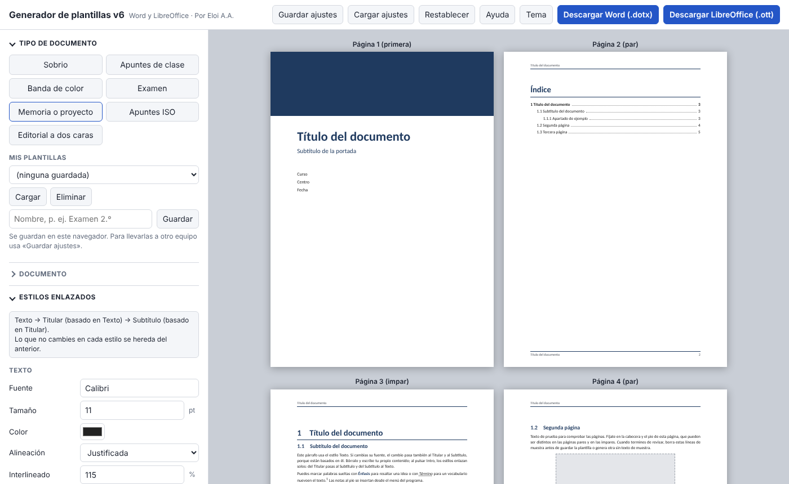

# Generador de plantillas v6

**Usarlo en línea:** https://eloiaa-hub.github.io/Plantilla-para-Office/

Programa HTML de un solo archivo, sin instalación y sin internet, para crear plantillas de documento para **Word (.dotx)** y **LibreOffice Writer (.ott)**.

- `Generador_Plantillas_v6.html`: el generador. Se abre con doble clic.
- `Manual_Generador_Plantillas_v6.html` y `Manual_Generador_Plantillas_v6.pdf`: manual de ayuda.
- `index.html`: portada para GitHub Pages.

Incluye estilos enlazados (Texto → Titular → Subtítulo), estilos opcionales, portada, índice automático, numeración de títulos, cabecera y pie configurables (también pares e impares), fondo de página, formatos de tabla, imágenes con pie numerado, notas al pie y tipos de documento de partida.

Autor: Eloi A.A.
